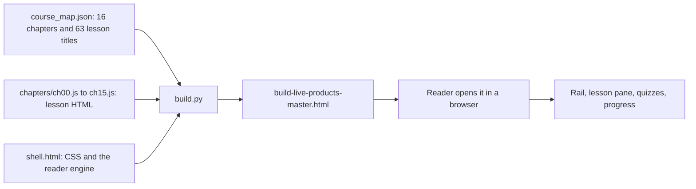
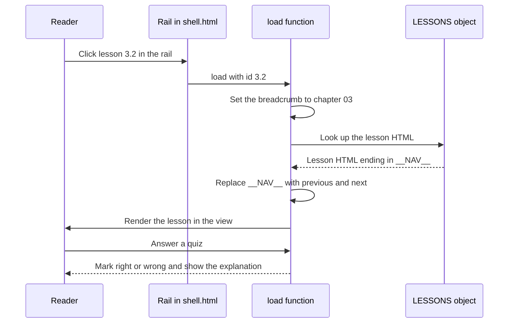

<!-- presentation:start -->
<p align="center"></p>

## Summary

Build Live Products is a free, build-first course that takes you from a raw problem to a live product with real users in about 4 weeks. It is 16 chapters and 63 lessons, about 169,209 words of lesson text, with 64 hand-drawn SVG figures, 120 self-grading quiz blocks and 60 real company cases. It is written as 16 small source files plus one curriculum file, and a 94-line Python script (`build.py`) stitches them into a single HTML file you can open in any browser. Each chapter makes one argument, and each lesson ends with a rep you run on your own product. This source repository holds the whole thing.

## At a glance

| Fact | Measured value |
|---|---|
| Chapters | 16 (numbered 00 to 15) |
| Lessons | 63 |
| Real teardowns | 10 full teardown lessons plus a capstone |
| Industry cases, one per lesson 1.1 to 15.10 | 60 |
| Words of lesson text, SVG markup excluded | 169,209 |
| Lines of lesson source in `chapters/` | 10,633 |
| SVG figures | 64 |
| Self-grading quiz blocks | 120 |
| Comparison and framework tables | 182 |
| Callout boxes (trap, why this wins, takeaway) | 376 |
| Sum of the "min read" pills across all lessons | 837 minutes |
| Generated course file | 11,025 lines, 1,417,199 bytes |
| Files in the repository | 25 |
| Languages | HTML, JavaScript, Python |
| Time to a live product | about 4 weeks |
| Cost to start | Free, no signup |

## What it is

A complete course, written and shipped as one self-contained HTML page. Open it and you get a left rail with all 16 chapters as collapsible toggles, a reading pane, a progress bar, previous and next buttons, and self-grading quizzes. There is no server and no framework. Everything the reader needs is inline in `build-live-products-master.html`; only fonts come from Google Fonts.

The course follows one rule: you measure progress by the artifact each chapter asks you to produce, not by chapters read. The last artifact is a URL you can send to someone. The worked examples follow GeniOS through every step while you run the same step on your own product.

Live version: https://hustlersfellowship.com/buildliveproducts

## Why it was built

Most courses hand you theory and trust you to apply it someday. The problem this course attacks is concrete: people finish a course with a folder of notes and no product in front of a stranger. The course's premise is that builders skip the unglamorous gates (is the problem real, will anyone pay, can the math work) and start building, then find out late.

So the course is built as a loop with a gate at the end of each stage. Chapter 03 is called "Validation: Will They Actually Pay" and ends in a lesson named "The Kill Gate". Chapter 13 ends with "Persevere, Pivot, or Kill". The course is willing to tell you to stop.

## How it works



1. **course_map.json** is the single source of truth for chapter and lesson titles and order. It also holds one `through_line` per chapter: the single argument every lesson in that chapter must support.
2. **chapters/chNN.js** holds the lesson content, one JavaScript object entry per lesson, keyed by lesson id such as `"3.2"`. The content is raw HTML inside a template literal.
3. **shell.html** is the engine: all the CSS plus the JavaScript that draws the rail, loads a lesson, grades quizzes and builds previous and next navigation.
4. **build.py** reads the curriculum, concatenates every `chapters/ch*.js`, finds each lesson key with a regular expression, marks each lesson `live` if its content exists or `soon` if not, computes the progress percentage, and replaces four placeholders in the shell (`__COURSE__`, `__LESSONS__`, `__ACTIVE__`, `__PROGRESS__`).
5. **The master file** is the only thing that ships. It is generated, so it is never edited by hand.
6. **The reader** opens the file. A click in the rail calls `load(id)`, which swaps the lesson HTML into the view and wires the quizzes.

## What makes it different

<p align="center"></p>

| | Build Live Products | A recorded video course | A reading list of articles | A template pack |
|---|---|---|---|---|
| Ends in | A live product with real users | A certificate of completion | More tabs open | Filled-in documents |
| Structure | 16 gated chapters, 63 lessons, each with one through-line | Modules, usually linear | Unordered | Unordered |
| Practice | An "Apply It Yourself" rep in 62 lessons | Optional exercises | None | Fill in the blanks |
| Worked example | The same company followed across every chapter | Varies | Varies | None |
| Real cases | 60, one per lesson 1.1 to 15.10 | A few | Varies | None |
| Says no | Kill gate and persevere, pivot or kill lessons | Rarely | No | No |
| Delivery | One HTML file, no signup, no server | A platform account | Browser | Download |
| Updating | Edit a chapter file, run one script | Re-record | Edit posts | Re-export |

## Features

| Feature | What it is | Where it lives |
|---|---|---|
| Collapsible chapter rail | All 16 chapters as toggles, lessons listed under each, live or soon tags | `buildNav()` and `bind()` in `shell.html` |
| Progress bar | Width set from the share of live lessons at build time | `__PROGRESS__` in `shell.html`, computed in `build.py` |
| Previous and next | Moves across chapter boundaries in course order | `nav()` and `navFor()` in `shell.html` |
| Self-grading quizzes | Two per lesson across 60 lessons; the right answer is revealed with an explanation | `bindQuiz()`, `data-correct` attribute, 120 quiz blocks |
| Seven-block lesson | Mandate, own vs not own, signals, how to think, frameworks, worked solution, industry case | `chapters/_TEMPLATE.js` and every `chNN.js` |
| Apply It Yourself reps | An open problem with hints and a strong vs weak answer table | 62 lessons |
| Hand-drawn SVG figures | At least one per lesson, no chart library | 64 `class="fig"` blocks |
| Teardown template | Product, problem, how it was solved, learnings, what you would execute | `chapters/_TEMPLATE_CASE.js`, Chapter 15 |
| Lesson state derivation | A lesson is `live` only if its key exists in a chapter file | regex in `build.py` |
| Placeholder view | A "ships next" page for any lesson not yet written | `load()` in `shell.html` |
| Phone layout | A menu button and scrim open the rail at 980px and below | `@media(max-width:980px)`, `menuBtn`, `scrim` |
| Chapter through-lines | One argument per chapter, stored with the title | 16 `through_line` fields in `course_map.json` |
| Authoring guide | Hard rules for ids, the `__NAV__` token and raw HTML content | `BUILD_GUIDE.md` |

## By the numbers

<p align="center"></p>

The ten longest chapters by words of lesson text. The Build Lab alone is about 18 percent of the whole course.

<p align="center"></p>

Words in each of the ten Chapter 15 teardown lessons, longest first.

<p align="center"></p>

What the 63 lessons are made of, counted from the source.

<p align="center"></p>

Lessons per chapter for chapters 1 to 10. Chapter 10, Building With AI, is the largest teaching chapter at 5 lessons.

### Every chapter, measured

| # | Chapter | Lessons | Words | Figures | Quiz blocks |
|---|---|---|---|---|---|
| 00 | Start Here | 2 | 1,847 | 2 | 0 |
| 01 | Understanding the Problem and the Customer | 4 | 9,786 | 5 | 8 |
| 02 | Ideation and Picking the Wedge | 3 | 8,863 | 3 | 6 |
| 03 | Validation: Will They Actually Pay | 4 | 11,628 | 4 | 8 |
| 04 | Feasibility, Pricing and Unit Economics | 4 | 12,045 | 4 | 8 |
| 05 | Positioning and Differentiation | 3 | 9,230 | 3 | 6 |
| 06 | Planning the Build | 4 | 10,814 | 4 | 8 |
| 07 | Documentation: PRD and User Journey | 3 | 8,060 | 3 | 6 |
| 08 | Prototyping: Fake It Before You Build It | 3 | 7,836 | 3 | 6 |
| 09 | The MVP: The Boring V1 | 3 | 8,368 | 3 | 6 |
| 10 | Building With AI | 5 | 13,693 | 5 | 10 |
| 11 | Execution: Ship It Live | 3 | 7,788 | 3 | 6 |
| 12 | Analytics: Instrument and Read the Truth | 4 | 10,535 | 4 | 8 |
| 13 | A/B Testing and Iteration | 3 | 8,087 | 3 | 6 |
| 14 | Launch and Grow Toward Retention | 4 | 10,858 | 4 | 8 |
| 15 | The Build Lab: 10 Real 0 to 1 Teardowns | 11 | 29,771 | 11 | 20 |
| | **Total** | **63** | **169,209** | **64** | **120** |

Chapter titles and lesson counts come from `course_map.json`. Words, figures and quiz blocks are counted in each `chapters/chNN.js`.

### The 10 teardowns in Chapter 15

Lesson 15.11 is a capstone, not a teardown. Each teardown is a full seven-block lesson with a figure, two quiz blocks and an Apply It Yourself rep.

| Lesson | Product | Angle | Words |
|---|---|---|---|
| 15.1 | Cursor | Fork the Incumbent, Go AI-Native | 3,237 |
| 15.2 | Perplexity | Position Against a Giant | 2,774 |
| 15.3 | ElevenLabs | Be the Best in the World at One Thing | 3,039 |
| 15.4 | Granola | The Boring MVP That Does One Job | 2,414 |
| 15.5 | Bolt.new | Launch as Distribution, Ride the Loop | 3,151 |
| 15.6 | Lovable | Build With AI, Ship at Insane Speed | 2,528 |
| 15.7 | Deel | Run Toward the Hard, Painful Problem | 2,358 |
| 15.8 | Cal.com | Open Source as Wedge, and the Three Objections | 3,284 |
| 15.9 | Linear | Craft Is a Strategy | 2,501 |
| 15.10 | Replit Agent | Build the Loop AI Can Run | 3,188 |

### The real cases behind the chapters

Every lesson from 1.1 to 15.10 closes its seventh block with an industry case. These are the names, by chapter.

| Chapter | Real cases studied, one per lesson |
|---|---|
| 01 Problem and customer | Harper, Mem0, Misprint, Salient |
| 02 Ideation and the wedge | Candle, Casca, Wuri |
| 03 Validation | LunaBill, MathDash, Spaceium, Cactus |
| 04 Feasibility and pricing | Maritime Fusion, Pivot Robotics, Parahelp, plus one unnamed build-underneath case |
| 05 Positioning | Legora, Pylon, Sourcebot |
| 06 Planning the build | Andy AI, Okibi, Theseus, Ambral |
| 07 PRD and user journey | OpenSpec, Ficra, plus one non-functional-requirement company |
| 08 Prototyping | Abundant, April, Human Behavior |
| 09 The MVP | Greptile, Mintlify, Substrate |
| 10 Building with AI | Mastra, Magic Patterns, stagewise, Emergent, plus two non-engineers who let AI build |
| 11 Execution | Trigger.dev, Browser Use, Wordware |
| 12 Analytics | Gumloop, Respan, Circleback, plus one healthy-looking-metrics case |
| 13 A/B testing | Spur, Pig.dev, plus one buy-depth case |
| 14 Launch and grow | PearAI, Chad, RealRoots, Happenstance |
| 15 Build Lab | Cursor, Perplexity, ElevenLabs, Granola, Bolt.new, Lovable, Deel, Cal.com, Linear, Replit Agent |

## Architecture



| Path | What it holds |
|---|---|
| `course_map.json` | Chapter and lesson titles, order and the through-line per chapter, 103 lines |
| `chapters/ch00.js` to `ch15.js` | The lesson content, 16 files, 10,633 lines in total |
| `chapters/_TEMPLATE.js` | Blank seven-block lesson skeleton |
| `chapters/_TEMPLATE_CASE.js` | Blank teardown skeleton for Chapter 15 |
| `shell.html` | All CSS and the reader engine, 282 lines |
| `build.py` | The stitcher, 94 lines, standard library only |
| `build-live-products-master.html` | Generated output, the file that ships |
| `BUILD_GUIDE.md` | Authoring rules and the build pipeline |

## Tech stack

| Technology | What it does here |
|---|---|
| HTML | Every lesson is raw HTML inside a JavaScript template literal |
| JavaScript | The reader engine: rail, lesson loading, quizzes, navigation |
| Python 3 | `build.py` uses only `json`, `re`, `glob`, `os` and `sys` |
| Inline SVG | All 64 figures are hand-drawn, with no chart library |
| CSS | Defined once in `shell.html`, with a fixed palette and a 980px breakpoint |
| Google Fonts | Hanken Grotesk, Newsreader and JetBrains Mono, loaded by the shell |
| JSON | `course_map.json` is the curriculum |

## Run it locally

```bash
python3 build.py
```

Run it inside the repository folder. It reads `course_map.json` and every `chapters/chNN.js`, injects them into `shell.html` and writes `build-live-products-master.html`. Open that file in a browser. Edits go in `chapters/` or `shell.html`, never in the generated file.

## Who it is for

- Founders, operators, indie hackers and students who want a product in real hands, not another folder of notes.
- People who will use AI at every step and still own every decision. Chapter 10 is entirely about building with AI.
- Anyone with a problem, or the willingness to go find one. Chapter 01 starts with where problems come from.
- Authors who want a pattern for shipping a long course as plain files and one script.

## FAQ

**Is Build Live Products free?**
Yes. It is free to start and needs no signup. It opens instantly at hustlersfellowship.com/buildliveproducts.

**How long does it take to build a product with this course?**
The course is framed around about 4 weeks from a raw problem to a live product. A commit in the repository changed the timeframe from sixty days to four weeks.

**How many lessons and teardowns are there?**
16 chapters, 63 lessons and 10 real teardowns, plus a capstone. Every lesson from 1.1 to 15.10 also has an industry case.

**How do I validate a startup idea with this course?**
Chapters 01 to 03 cover it: sourcing a problem, talking to customers with the Mom Test, running a weekend smoke test, pre-selling, and a kill gate.

**Can I use AI to build my MVP?**
Chapter 10 covers PRDs and decisions with AI, prompting by unit level, UI and UX with AI, vibe-coding for prototypes versus coding agents for MVPs, and the product levels from UI to QA.

**How do I rebuild the course from source?**
Run `python3 build.py`. It needs only Python 3 and writes the single master HTML file.

Built by [Rohit Swerashi](https://github.com/therohitji), Founder & CEO of [GeniOS](https://thegenios.com).
<!-- presentation:end -->

## Full documentation

# Build Live Products (2026)

A build-first course that takes you from a raw problem to a live product with real users, in about 4 weeks. By **Rohit Swerashi**, founder of GeniOS, taught through the **Hustlers Fellowship**.

**Read it live:** https://hustlersfellowship.com/buildliveproducts

This repository holds the full source of the course: the curriculum, every lesson, the figures, and the small build script that stitches them into one self-contained HTML file you can open in any browser.

## What this is

Most courses hand you theory and trust you to apply it someday. This one is a loop you run. It makes a single promise: if you do the work, you finish with a live product that solves a real problem and has real users, built in about four weeks. You measure progress not by chapters read but by the artifact each chapter asks you to produce. The certificate at the end is the URL you can send someone.

The course follows one real startup, GeniOS, as the worked example through every step, while you run the same step on your own product.

## Who it is for

- Builders who will actually ship: founders, operators, indie hackers, and students who want a product in real hands, not another folder of notes.
- People who will use AI at every step and still own every decision.
- Anyone with a problem, or the willingness to go find one.

It is not for people who want theory to file away, or a guarantee before they start.

## The arc

Sixteen chapters, one arc, from a real problem to a live product. Every chapter is a gate you earn before the next.

| # | Chapter | Lessons |
|---|---------|---------|
| 0 | Start Here | 2 |
| 1 | Understanding the Problem and the Customer | 4 |
| 2 | Ideation and Picking the Wedge | 3 |
| 3 | Validation: Will They Actually Pay | 4 |
| 4 | Feasibility, Pricing and Unit Economics | 4 |
| 5 | Positioning and Differentiation | 3 |
| 6 | Planning the Build | 4 |
| 7 | Documentation: PRD and User Journey | 3 |
| 8 | Prototyping: Fake It Before You Build It | 3 |
| 9 | The MVP: The Boring V1 | 3 |
| 10 | Building With AI | 5 |
| 11 | Execution: Ship It Live | 3 |
| 12 | Analytics: Instrument and Read the Truth | 4 |
| 13 | A/B Testing and Iteration | 3 |
| 14 | Launch and Grow Toward Retention | 4 |
| 15 | The Build Lab: 10 Real 0 to 1 Teardowns | 11 |

That is **63 lessons across 16 chapters**.

## How each lesson works

Every teaching lesson follows the same seven-block shape, so you always know where you are:

1. **Your Mandate** the one job of this step
2. **What You Own vs What You Do Not Own** where the line sits
3. **Signals to Watch** what tells you it is working, or not
4. **How to Think** the mental model, with one figure
5. **Frameworks to Deploy** the tools you actually use
6. **The GeniOS Worked Solution** the step run on a real product
7. **A Real Industry Case** a recent, verified company that lived it

Each lesson then ends with **Check Yourself** (two quick questions) and **Apply It Yourself**, the rep you do on your own product. The reps are the course; everything else is setup.

## The Build Lab

The final chapter is a Build Lab: ten teardowns of real, recent 0 to 1 products, read the way a builder reads them, plus a capstone that turns the whole course into a one-page plan for your own product.

## Repository layout

```
.
├── build-live-products-master.html   # the generated, ready-to-read course (single file)
├── build.py                          # stitches the course together
├── shell.html                        # the app shell: all CSS and the reader engine
├── course_map.json                   # the curriculum: chapter and lesson titles, in order
├── chapters/                         # lesson content, one file per chapter (chNN.js)
└── BUILD_GUIDE.md                    # authoring rules and the build pipeline
```

## Build it yourself

The course is a single static HTML file generated from the sources. No dependencies beyond Python 3.

```bash
python3 build.py
```

That reads `course_map.json` and every `chapters/chNN.js`, injects them into `shell.html`, and writes `build-live-products-master.html`. Open that file in any browser to read the course.

Never hand-edit the generated file; it is overwritten on every build. All edits go in `chapters/` or `shell.html`. See [BUILD_GUIDE.md](BUILD_GUIDE.md) for the full authoring rules: lesson structure, the figure palette, and the house style.

## Credits

Written by **Rohit Swerashi**, founder of GeniOS, for the **Hustlers Fellowship**. Companion course: [AI Product Management](https://hustlersfellowship.com/aipm).

Free to read and learn from. Please do not repackage or resell the content.
