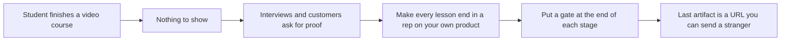
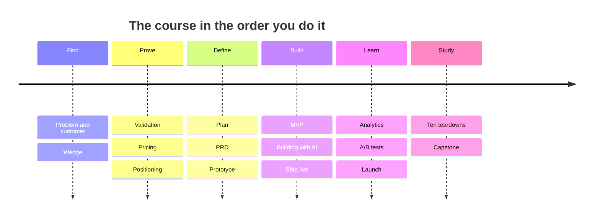

<!-- presentation:start -->
<p align="center"></p>

Build Live Products is a free course for people who want a product in front of real users, not another folder of notes. It has 16 chapters and 63 lessons, and every lesson ends with something you do on your own product. It is live at [hustlersfellowship.com/buildliveproducts](https://hustlersfellowship.com/buildliveproducts), and this repository holds the whole source.

## The problem

I mentor students and early builders. Many of them had watched every course on offer and still had nothing to show. A video can be finished without making a single decision, so a person can reach the last lesson with the same blank page they started with. Interviews and first customers reward proof, and a certificate is not proof.

Builders also skip the dull gates. Is the problem real, will anyone pay, does the math work. They start building, and find out months late. About 500 people read the Hustlers Fellowship material and more than 20 professionals checked it before it went wide. That feedback shaped the rule this course runs on: progress is the artifact you produced, not the chapters you read.

## How I approached it



**Key decisions**

| Decision | Why | Trade-off |
|---|---|---|
| Every lesson ends in an Apply It Yourself rep (62 of them) | A rep forces a decision, and a decision is what a video never asks for | Slower than watching, and some readers will skip them |
| Gates that can say stop: "The Kill Gate" in chapter 03, "Persevere, Pivot, or Kill" in chapter 13 | A course that only encourages teaches nothing about when to quit | Some readers will leave with a smaller idea than they came with |
| One real company case in every lesson, 60 in total | Cases show a real decision at a real company, so the advice has a source | Cases age, and each one needs checking before it ships |
| Ten full teardowns in a closing Build Lab | Frameworks are theory until you watch them run on a product built from zero | The Build Lab is 18 percent of all the text, a long read |
| Worked examples follow GeniOS through every step | One product followed end to end teaches more than ten sketches | Examples lean on a single company's path |
| Curriculum in one JSON file, one small source file per chapter, one script to build | A broken new chapter cannot damage a finished one | There is a build step before anything publishes |

## What I built

| What | In plain words | Where |
|---|---|---|
| The course | 16 chapters, 63 lessons, about 169,000 words | `chapters/ch00.js` to `ch15.js` |
| The reader | A chapter rail, reading pane, progress bar and self-grading quizzes in one page | `shell.html` |
| The curriculum | Titles, order and one argument per chapter | `course_map.json` |
| The publisher | A 94-line script that stitches it all into one HTML file | `build.py` |
| The teardowns | Ten real products, plus a capstone, in chapter 15 | `chapters/ch15.js` |
| The authoring rules | Lesson skeleton and what makes a lesson acceptable | `BUILD_GUIDE.md`, `chapters/_TEMPLATE.js` |

### Chapter by chapter

| # | Chapter | Lessons | The question it answers |
|---|---|---|---|
| 00 | Start Here | 2 | What does finishing look like |
| 01 | Understanding the Problem and the Customer | 4 | Is this problem painful and frequent |
| 02 | Ideation and Picking the Wedge | 3 | What is the narrowest thing someone pays for |
| 03 | Validation: Will They Actually Pay | 4 | Is there evidence of demand before code |
| 04 | Feasibility, Pricing and Unit Economics | 4 | Does the math work |
| 05 | Positioning and Differentiation | 3 | Why this over the status quo |
| 06 | Planning the Build | 4 | What gets built first |
| 07 | Documentation: PRD and User Journey | 3 | What is the one-page spec |
| 08 | Prototyping: Fake It Before You Build It | 3 | Can I get a reaction cheaply |
| 09 | The MVP: The Boring V1 | 3 | What is the smallest real version |
| 10 | Building With AI | 5 | How do I direct an AI coding agent |
| 11 | Execution: Ship It Live | 3 | How do I get live fast |
| 12 | Analytics: Instrument and Read the Truth | 4 | Is anyone actually using it |
| 13 | A/B Testing and Iteration | 3 | Persevere, pivot or kill |
| 14 | Launch and Grow Toward Retention | 4 | Where do the first users come from |
| 15 | The Build Lab: 10 Real 0 to 1 Teardowns | 11 | How did real products do it |

### The ten teardowns

| Product | The lesson taken from it |
|---|---|
| Cursor | Fork the incumbent, go AI-native |
| Perplexity | Position against a giant |
| ElevenLabs | Be the best at one thing |
| Granola | The boring MVP that does one job |
| Bolt.new | Launch as distribution |
| Lovable | Build with AI, ship fast |
| Deel | Run toward the hard, painful problem |
| Cal.com | Open source as a wedge |
| Linear | Craft as a strategy |
| Replit Agent | Build the loop AI can run |

## How it works

1. `course_map.json` lists every chapter and lesson in order, with the one argument each chapter must support.
2. Each `chapters/chNN.js` holds that chapter's lessons as plain HTML, keyed by lesson number such as `"3.2"`.
3. `shell.html` holds the page design and the reader.
4. `build.py` reads all of it, marks each lesson live or coming soon, works out progress, and writes one file, `build-live-products-master.html`.
5. The reader opens that file in a browser. There is no server and nothing to log into.



## What makes it different

<p align="center"></p>

| | Build Live Products | A recorded video course | A reading list of articles | A template pack |
|---|---|---|---|---|
| Ends in | A live product with real users | A certificate of completion | More tabs open | A folder of blank documents |
| Each lesson | Seven blocks and a rep on your own product | Watch and move on | Read and move on | Fill in a form |
| Can it tell you to stop | Yes, two named gates | Rarely | No | No |
| Real examples | 60 company cases, 10 full teardowns | A few anecdotes | Scattered | None |
| To start | Open a page | Create an account | Find the posts | Download |

## By the numbers

<p align="center"></p>

The Build Lab is about 18 percent of the course, so the teardowns are a large part of it and not an appendix.

<p align="center"></p>

Every teardown is a full lesson of 2,300 to 3,300 words, so none is a summary.

<p align="center"></p>

The 120 self-grading quizzes and 62 reps are what turn reading into practice.

## What this shows

- I start from a specific failure, students who finished courses and had nothing to show, and design the product against it.
- I will put a stop sign in my own product. The course tells readers to kill an idea when the evidence says so.
- I keep big things maintainable: sixteen small files and one script instead of one giant page edited by hand.
- Every claim about content is countable. The word, quiz and figure numbers above come from scripts run on the source.

## What I would do next

- Measure how many readers reach the live-product step. The "about 4 weeks" framing is a design target, not a measured result.
- Add a way for readers to submit their final URL and get feedback.
- Refresh the 60 company cases on a schedule, because cases go stale.

## Tech stack

| Technology | What it does here |
|---|---|
| HTML | Every lesson is plain HTML inside a JavaScript template string |
| JavaScript | The reader: rail, lesson loading, quizzes, navigation |
| Python 3 | `build.py`, standard library only |
| Inline SVG | All 64 figures are hand-drawn, no chart library |
| JSON | `course_map.json` is the curriculum |

## Run it locally

```bash
python3 build.py
```

Run it inside the repository folder, then open `build-live-products-master.html` in a browser. Edit `chapters/` or `shell.html`, never the generated file.

Built by [Rohit Swerashi](https://github.com/therohitji), Founder & CEO of [GeniOS](https://thegenios.com). [Book a call](https://cal.com/rohitswerashi/genios).

<details>
<summary>Full technical documentation</summary>

# Build Live Products (2026)

A build-first course that takes you from a raw problem to a live product with real users, in about 4 weeks. By **Rohit Swerashi**, founder of GeniOS, taught through the **Hustlers Fellowship**.

**Read it live:** https://hustlersfellowship.com/buildliveproducts

This repository holds the full source of the course: the curriculum, every lesson, the figures, and the small build script that stitches them into one self-contained HTML file you can open in any browser.

## What this is

Most courses hand you theory and trust you to apply it someday. This one is a loop you run. It makes a single promise: if you do the work, you finish with a live product that solves a real problem and has real users, built in about four weeks. You measure progress not by chapters read but by the artifact each chapter asks you to produce. The certificate at the end is the URL you can send someone.

The course follows one real startup, GeniOS, as the worked example through every step, while you run the same step on your own product.

## Who it is for

- Builders who will actually ship: founders, operators, indie hackers, and students who want a product in real hands, not another folder of notes.
- People who will use AI at every step and still own every decision.
- Anyone with a problem, or the willingness to go find one.

It is not for people who want theory to file away, or a guarantee before they start.

## The arc

Sixteen chapters, one arc, from a real problem to a live product. Every chapter is a gate you earn before the next.

| # | Chapter | Lessons |
|---|---------|---------|
| 0 | Start Here | 2 |
| 1 | Understanding the Problem and the Customer | 4 |
| 2 | Ideation and Picking the Wedge | 3 |
| 3 | Validation: Will They Actually Pay | 4 |
| 4 | Feasibility, Pricing and Unit Economics | 4 |
| 5 | Positioning and Differentiation | 3 |
| 6 | Planning the Build | 4 |
| 7 | Documentation: PRD and User Journey | 3 |
| 8 | Prototyping: Fake It Before You Build It | 3 |
| 9 | The MVP: The Boring V1 | 3 |
| 10 | Building With AI | 5 |
| 11 | Execution: Ship It Live | 3 |
| 12 | Analytics: Instrument and Read the Truth | 4 |
| 13 | A/B Testing and Iteration | 3 |
| 14 | Launch and Grow Toward Retention | 4 |
| 15 | The Build Lab: 10 Real 0 to 1 Teardowns | 11 |

That is **63 lessons across 16 chapters**.

## How each lesson works

Every teaching lesson follows the same seven-block shape, so you always know where you are:

1. **Your Mandate** the one job of this step
2. **What You Own vs What You Do Not Own** where the line sits
3. **Signals to Watch** what tells you it is working, or not
4. **How to Think** the mental model, with one figure
5. **Frameworks to Deploy** the tools you actually use
6. **The GeniOS Worked Solution** the step run on a real product
7. **A Real Industry Case** a recent, verified company that lived it

Each lesson then ends with **Check Yourself** (two quick questions) and **Apply It Yourself**, the rep you do on your own product. The reps are the course; everything else is setup.

## The Build Lab

The final chapter is a Build Lab: ten teardowns of real, recent 0 to 1 products, read the way a builder reads them, plus a capstone that turns the whole course into a one-page plan for your own product.

## Repository layout

```
.
├── build-live-products-master.html   # the generated, ready-to-read course (single file)
├── build.py                          # stitches the course together
├── shell.html                        # the app shell: all CSS and the reader engine
├── course_map.json                   # the curriculum: chapter and lesson titles, in order
├── chapters/                         # lesson content, one file per chapter (chNN.js)
└── BUILD_GUIDE.md                    # authoring rules and the build pipeline
```

## Build it yourself

The course is a single static HTML file generated from the sources. No dependencies beyond Python 3.

```bash
python3 build.py
```

That reads `course_map.json` and every `chapters/chNN.js`, injects them into `shell.html`, and writes `build-live-products-master.html`. Open that file in any browser to read the course.

Never hand-edit the generated file; it is overwritten on every build. All edits go in `chapters/` or `shell.html`. See [BUILD_GUIDE.md](BUILD_GUIDE.md) for the full authoring rules: lesson structure, the figure palette, and the house style.

## Credits

Written by **Rohit Swerashi**, founder of GeniOS, for the **Hustlers Fellowship**. Companion course: [AI Product Management](https://hustlersfellowship.com/aipm).

Free to read and learn from. Please do not repackage or resell the content.

</details>

<!-- presentation:end -->
